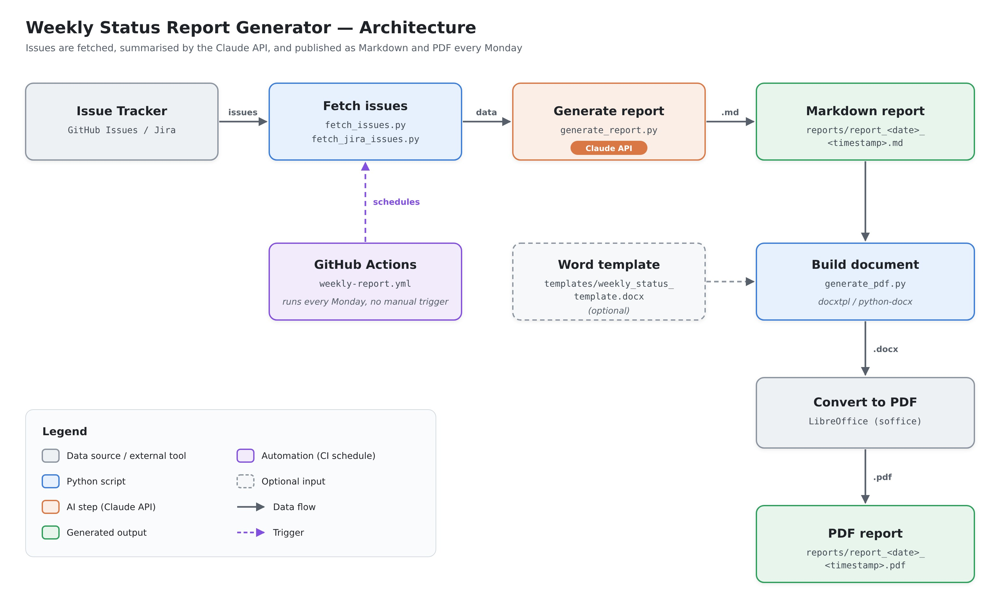

# AI-Powered PM Status Report Generator

An automation pipeline that turns raw project activity (GitHub or Jira issues today, easily
adaptable to Azure DevOps or others) into a structured, stakeholder-ready weekly status report —
written by Claude, generated on a schedule, with zero manual effort.

## The problem

Writing a good weekly status report takes real time: pulling ticket state, mentally
triaging what's actually a risk versus noise, and translating engineering detail into
something an exec steering committee can absorb in 30 seconds. On a program with dozens
of open items, this is 30–60 minutes of manual synthesis every week — repeated forever.

## The approach

1. **Fetch** — pull recent issue activity (title, labels, assignee, comments, timestamps) from
   whichever tracker is configured — the GitHub REST API or the Jira Cloud REST API.
2. **Synthesize** — pass that raw data to Claude with a system prompt that encodes an
   opinionated PM reporting structure (Executive Summary → Progress → Risks & Blockers →
   Upcoming → Metrics), the same structure I used for steering committee reporting on the
   UGW and AVB/TSN programs at Cetitec.
3. **Render** — convert that Markdown into a stakeholder-ready PDF, optionally through a
   Word template so it carries your organization's own letterhead/branding.
4. **Automate** — a GitHub Actions workflow runs this every Monday morning and commits the
   generated `.md` and `.pdf` straight into the repo. No one has to remember to run it.

This mirrors the same instinct behind a Jenkins CI pipeline I built at Bosch to
automate HIL regression execution — take a recurring manual task, make the machine do it
on a schedule, and only involve a human when something actually needs a decision.

## Architecture


Output filenames: `reports/report_<date>_<timestamp>.md` and `reports/report_<date>_<timestamp>.pdf`
(e.g. `report_2026-07-27_143022.md`) — the timestamp keeps repeated same-day runs from
overwriting each other. The PDF is
always generated. If `templates/weekly_status_template.docx` exists, its `{{p report_content}}`
placeholder is filled in with the report content, preserving the rest of the template
(letterhead, cover page, headers/footers) — see [`templates/README.md`](templates/README.md).
If it doesn't exist, a plain Word document is generated automatically instead.

## Example output

See [`reports/example_output_github.md`](reports/example_output_github.md) (generated from
`sample_data/github_sample_issues.json`) or [`reports/example_output_jira.md`](reports/example_output_jira.md)
(generated from `sample_data/jira_sample_issues.json`) for a full sample report — no API key
needed to see what this produces. `--sample` picks whichever pair matches `ISSUE_TRACKER`, and so
does the offline `--sample --dry-run` path (see below).

## Running it yourself

```bash
git clone <this-repo>
cd pm-status-report-generator
pip3 install -r requirements.txt
cp .env.example .env   # fill in your GitHub token (default) or Jira credentials, + Anthropic API key
```

The PDF report is generated by converting a Word document with headless LibreOffice, so
`soffice` must be installed locally:

```bash
brew install --cask libreoffice                                    # macOS
sudo apt-get install -y libreoffice --no-install-recommends         # Linux
```

Note: on macOS, LibreOffice's `soffice` binary isn't on `PATH` by default even after
installing via Homebrew — the tool automatically falls back to the app bundle path
(`/Applications/LibreOffice.app/Contents/MacOS/soffice`) if `soffice` isn't found on `PATH`.

```bash
# Try it against the bundled synthetic data (no live GitHub/Jira credentials
# needed, but you do need an Anthropic API key for the actual generation step)
python3 src/main.py --sample

# Zero API calls, zero API key needed: writes report_<date>_<timestamp>.md/.pdf
# from the bundled sample report matching ISSUE_TRACKER (example_output_github.md
# or example_output_jira.md). The best way to test the PDF pipeline — or a custom
# templates/weekly_status_template.docx — for free.
python3 src/main.py --sample --dry-run

# Against a live tracker, --dry-run alone just prints the prompt that would be
# sent to Claude and writes no files (no canned report exists for live data)
python3 src/main.py --dry-run

# Point it at a real GitHub repo or Jira project (set ISSUE_TRACKER accordingly)
python3 src/main.py
```

Every run produces two files under `reports/`, named after the current date and time —
**except** plain `--dry-run` against a live tracker, which is prompt-preview only and writes
nothing. The timestamp means repeated same-day runs never overwrite a previous one:

```
reports/report_<date>_<timestamp>.md    # the raw Markdown report
reports/report_<date>_<timestamp>.pdf   # the same content rendered as a PDF
```

The PDF is generated automatically whenever the `.md` is — no extra flag needed. By default
it's a plain auto-generated Word doc converted to PDF; if you've dropped a branded template at
`templates/weekly_status_template.docx`, that's used instead so the PDF carries your own
letterhead/cover page (see [`templates/README.md`](templates/README.md) for the convention).
The CLI prints both output paths when it finishes, e.g.:

```
Report written to reports/report_2026-07-27_143022.md
PDF report written to reports/report_2026-07-27_143022.pdf
```

## Fetching from Jira instead of GitHub

Jira Cloud is supported out of the box — no code changes needed. Set in `.env`:
```
ISSUE_TRACKER=jira
JIRA_BASE_URL=https://your-company.atlassian.net
JIRA_EMAIL=you@example.com
JIRA_API_TOKEN=...          # https://id.atlassian.com/manage-profile/security/api-tokens
JIRA_PROJECT_KEY=PROJ
```
`src/fetch_jira_issues.py` builds a JQL query from the same `ISSUE_STATE` / `ISSUE_LABELS` /
`LOOKBACK_DAYS` knobs already used for GitHub filtering, and returns the same list-of-dicts shape
the rest of the pipeline expects — the prompt, report generation, and PDF rendering are all
tracker-agnostic and need no changes either way.

## Adapting this for Azure DevOps / other trackers

Both `fetch_issues.py` (GitHub) and `fetch_jira_issues.py` (Jira) are tracker-specific modules
that return an identical list-of-dicts shape, dispatched from `src/main.py` based on
`ISSUE_TRACKER`. To add another tracker, follow the same pattern: write a
`fetch_<tracker>_issues.py` returning that same shape, and extend the dispatch in `main.py` — the
rest of the pipeline needs no changes.

## Testing

A blackbox regression suite lives under [`testing/`](testing/README.md) — it drives the real CLI
and inspects its outputs, covering both trackers, the PDF pipeline, and error handling. Tests
needing real credentials auto-skip when `.env` isn't configured for them, so it's safe to run
out of the box:

```bash
pip3 install -r requirements.txt -r testing/requirements.txt
python3 testing/run_tests.py
```

Writes both a Markdown and an HTML report to `testing/reports/` — see
[`testing/reports/example_test_report.md`](testing/reports/example_test_report.md) for a sample.

## Why this matters for the PM role, not just the code

The report format itself reflects real PM judgment: flagging unassigned blockers as a
distinct risk category, calling out staleness (no update in N days) as a signal worth
surfacing to leadership, and keeping the executive summary to a single actionable
sentence. The system prompt in `src/generate_report.py` is where that judgment lives —
tune it and you change what "good" looks like for your organization's reporting culture.

## Tech stack

Python · Claude API (Anthropic SDK) · GitHub REST API · Jira Cloud REST API · GitHub Actions ·
python-docx / docxtpl · LibreOffice (headless PDF conversion)

## Author

Mazen Yousef — Technical Project Manager, PMP-certified, automotive/embedded software
background. [LinkedIn](https://linkedin.com/in/mazenyousef)
